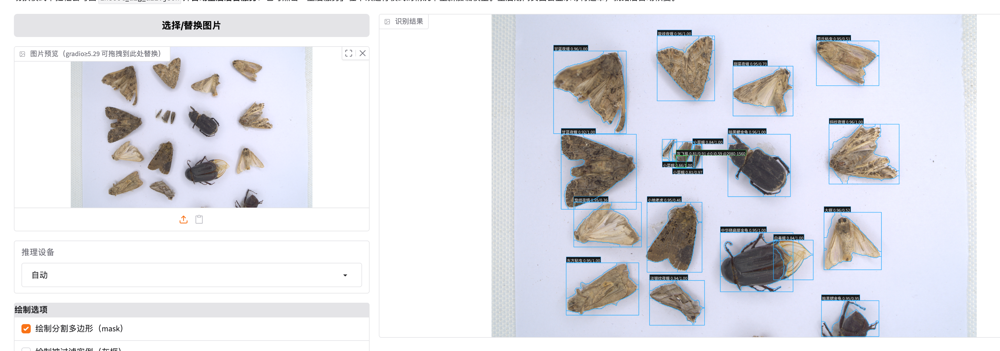
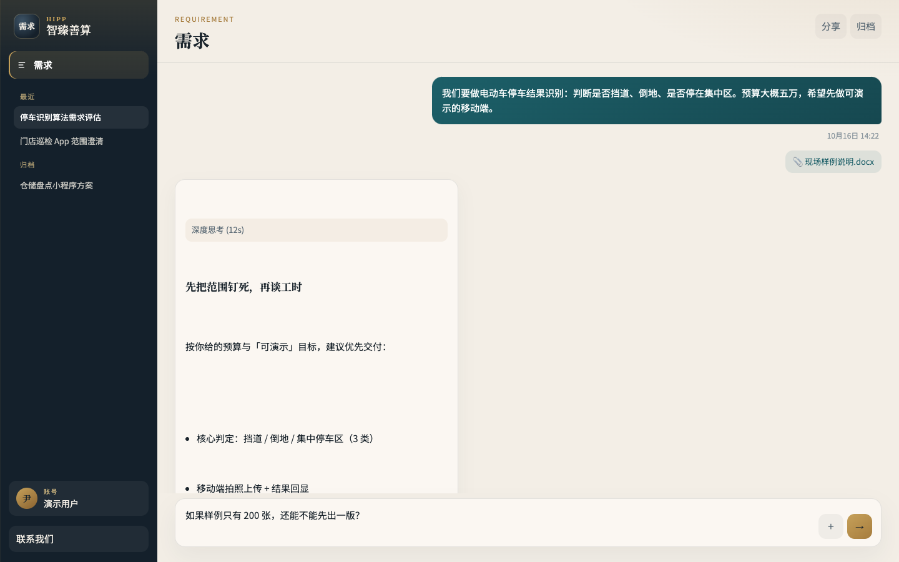

- 👋 Hi, I'm **Shunyao Yin** (@yinshunyao)
- 📫 Contact: **WeChat: 17302868369**

## About Me

AI product engineer with hands-on experience in **Python full-stack development**, **AI agent platform engineering**, **CV annotation system design**, and **end-to-end industrial / agricultural CV delivery** (data prep → train → deploy → serve).  
I focus on turning complex AI workflows into stable, usable products with clear architecture and efficient delivery — especially **config-driven multi-model inference** for field devices and production lines.

## Core Technical Strengths

- **Python engineering**: Django / FastAPI / Flask / gRPC, API design, service orchestration, and automation tooling
- **AI application integration**: LLM integration (Qwen), agent execution flow design, tool calling and capability abstraction
- **Data & annotation systems**: multi-source data ingestion, template-based annotation workflow, 3D annotation scenario support
- **CV/ML engineering**: PyTorch / OpenCV / NumPy; YOLO detect·segment·cls, RT-DETR / RF-DETR, ConvNeXt / timm, ArcFace; VOC/YOLO/COCO data pipelines and hard-case augmentation
- **CV inference & deployment**: config-driven multi-root pipelines; **YOLO / ONNX Runtime / TensorRT** backends; per-class confidence & diagonal-size (`dia`) filters; relative-size rerank; Gradio + FastAPI / HTTP serving; encrypted customer-side train packages
- **Delivery & maintainability**: modular architecture, environment bootstrap scripts, reproducible local deployment, and operation-friendly design

## Project Highlights

### 1) Insect Pest Recognition — Train-to-Serve CV Platform

End-to-end pest identification for **sticky-trap field devices, lab evaluation, and production APIs** — covering data augmentation, multi-framework training, config-driven inference, and online delivery.

Open inference reference: **[yinshunyao/script](https://github.com/yinshunyao/script)**

**Training & data**

- Built a field-oriented train suite: detect-for-localize → classify-for-species (avoids near-species collisions on one detect head)
- Covered rare / stacked / occluded insects via transparent-bug augmentation, background paste, and per-class sampling quotas
- Unified VOC/YOLO multi-source merge; YOLO / RetinaNet / RT-DETR detection and YOLO-cls / ConvNeXt / DINOv3 / ArcFace classification entries

**Inference & filtering (JSON-configurable)**

- **Multi-backend detect**: Ultralytics YOLO (`.pt`), TensorRT (`.engine`), ONNX Runtime (`.onnx`) on the same `PredictSize` pipeline; YOLO segment + nested YOLO-cls / timm ConvNeXt
- **Config-driven routing**: recursive `out` → `models.cls` decision tree (class / regex / diagonal-size interval keys); lab / field / custom profiles via `run_model` without code changes
- **Confidence & size gates**: root + per-class `detect_conf` / `cls_conf`, large/small body-size floors, pixel or mm diagonal (`dia` / `dia_mm`), and **same-image relative-size rerank** when top-1 scale mismatches peers
- **Geometry & morphology**: same-class IoU merge, big/small IoR nesting filters, `mask_rate`, dark-ratio, sticky-trap ROI, multi-scale sliding windows, in-big small-insect recovery
- **Explainable rejects**: `filter_reason` on dropped instances (threshold / cls / dia / relative_size / geometry / …)

**Serving & quality loop**

- Gradio test UI + FastAPI REST (`/insect_3_predict`), health checks, warmup, hot profile switching, TensorRT / batch / multi-process pools for GPU throughput
- Built-in Pascal VOC validation, incremental batch resume, Label Studio hard-case export, and offline det/cls threshold grid search

**Beijing competition stack (`det-v2.0.5` + `cls-3.12.2`)**

| Scene | Metric | Result |
|:---|:---|---:|
| Staged (`baipai`) | Corrected official score | **86.50%** |
| Staged | Instance accuracy (TP/FN/FP) | 89.08% (914 / 41 / 71) |
| Field (`shengchan`, 67 imgs) | Score with ID=0 false reports | **64.71%** |
| Field | Score ID≥3 only | **78.09%** |
| Field | Instance accuracy | 91.48% (1385 / 23 / 63) |

### 2) Scanly — Furniture Edge-Banding Defect Detection

Line-scan / panel CV for **furniture edge-banding defects** on production boards: locate → classify → board-level NG / label / discharge decisions across three cameras (top / side / bottom).

Open project: **[yinshunyao/scanly](https://github.com/yinshunyao/scanly)**

**Scope**

- **Detection backends**: YOLO, detect-core (RT-DETRv2), detect-mark, OBB
- **Taxonomy**: core defects (e.g. GlueSeam / Tackless / GlueGap / GlueResidue / BandBroken …), shielded non-defects (ResidualTape / Hole / Zigzag / Label), scheme-gated rares
- **Edge serving**: HTTP + Gradio with area thresholds and per-class enable flags; customer machines can run **pyfernet-encrypted** train packages (no plaintext `.py` on disk)

**Current delivery pick (v3.3.1, RT-DETRv2 r34, 3 classes: GlueSeam / Tackless / GlueGap)**

| Metric | Value |
|:---|---:|
| val mAP50-95 / mAP50 | **0.391** / 0.783 |
| test mAP50-95 | **0.356** |
| test box F1 (conf 0.5) | 0.777 |
| Images with ≥1 hit (has GT) | **212 / 234** |
| Online latency (CUDA ORT, warmed) | ≈ **33–38 ms**/image |

### 3) AI Annotation Product — Data Access & Annotation Efficiency

- Delivered **multi-source data access** in one entry point (local upload, HTTP incremental pull, MinIO/SFTP/FTP, etc.)

- Added **data preview before source creation** to reduce wrong-data ingestion risk and improve data preparation quality

- Enabled **intelligent code generation for annotation templates**, significantly reducing configuration cost for complex tasks

- Supported **3D point-cloud cuboid annotation** workflows, expanding product capability to advanced spatial scenarios

### 4) hipp-or — Intelligent Requirements Analysis Product

Product **hipp-or** (“clarify the requirement before talking implementation”): multi-client LLM requirements consulting with wallet billing, built on [kinit](https://github.com/vvandk/kinit) and wired to **Dify** (keys stay server-side) plus shared identity/wallet via **hipp-manager** (product code `or`).

Open project: **[yinshunyao/hipp-or](https://github.com/yinshunyao/hipp-or)** · Live: [hipp.site/or/](http://hipp.site/or/)

- **Stack**: FastAPI (`hipp-api`) + Vue user web (`hipp-web`) + Vue admin (`hipp-admin`) + uni-app mini program (`hipp-uni`)
- **Chat**: WebSocket streaming to Dify Chat (SSE/HTTP fallback); multimodal attachments; archive / share read-only links; stable business `code` + `message` (e.g. balance insufficient)
- **Monetization**: SMS/password login with SSO to `/mgr/`; wallet recharge & session deduct; ecommerce short-link one-shot cards (`/a/{token}`)
- **Ops**: same-site subpath deploy (`/or/`, `/or/manager/`, `/or/api/`); agent configs in admin (`vadmin_agent`) without shipping Dify secrets to clients

## Open Repositories

| Repo | Description |
|:---|:---|
| [yinshunyao/script](https://github.com/yinshunyao/script) | Insect pest config-driven multi-root inference (Gradio + REST) |
| [yinshunyao/scanly](https://github.com/yinshunyao/scanly) | Furniture edge-banding defect train / eval / edge serve |
| [yinshunyao/hipp-or](https://github.com/yinshunyao/hipp-or) | Intelligent requirements analysis (Web / admin / mini program) |
| [yinshunyao/yinshunyao](https://github.com/yinshunyao/yinshunyao) | This GitHub profile README |

## Collaboration Focus

- Open to collaborations on **AI products**, **LLM conversational apps**, **Web backend systems**, **CV data/annotation platforms**, **agricultural / industrial CV**, and **CV inference / MLOps delivery**
- Strong preference for projects that require both **engineering depth** and **product delivery speed**

<!---
yinshunyao/yinshunyao is a ✨ special ✨ repository because its `README.md` (this file) appears on your GitHub profile.
You can click the Preview link to take a look at your changes.
--->
